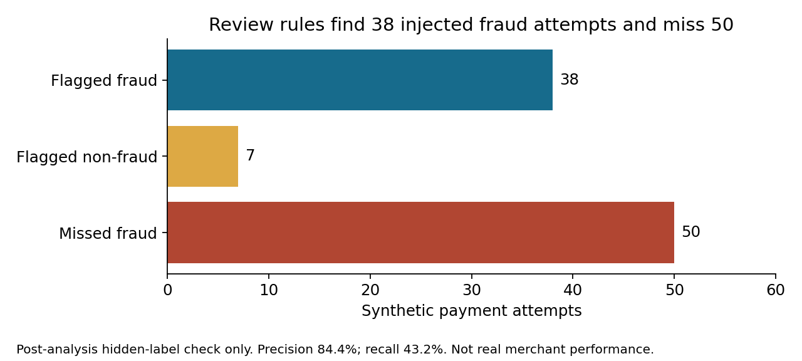

# Payment fraud investigation: a synthetic SQL case

## Decision brief

A fictional online retailer asks its risk analyst to review payment attempts from a recent quarter. The analyst must identify patterns for manual review, estimate settled fraud losses, and recommend the next investigation step. The case does not assume that any single rule proves fraud.

**Result:** In 5,024 synthetic attempts, 32 fraud disputes had a final lost outcome. Their modeled net loss was **$12,057.75**, including dispute fees. Another 16 fraud disputes were pending, with **$25,281.20** in combined confirmed and pending exposure. Three simple SQL rules flagged 45 attempts. In a separate post-analysis check against hidden simulated labels, 38 flags matched injected fraud and 7 did not. The rules missed 50 injected fraud attempts. Treat these values as a teaching example, not real company results or a production fraud model.

## Data and metric definitions

All businesses, accounts, card tokens, payments, disputes, and outcomes are fictional. `generate_data.py` creates 5,024 attempts with a fixed seed. `payments.csv` contains the analyst-visible fields. `simulation_truth.csv` stores injected fraud labels and pattern names separately. The SQL investigation does not read the truth file. `validate_rules.py` uses it only after the analysis, to check how the rules behaved on this known simulation.

The transaction table has one row per payment attempt. A payment attempt is not the same as a settled payment. Times are UTC ISO 8601 strings. All amounts are integer US cents. The simulated data uses USD only.

- **Confirmed fraud loss:** For a fraud dispute with final outcome `lost`, count the lesser of the chargeback and captured amount after refunds, plus the modeled dispute fee.
- **Pending exposure:** Add the same amount for fraud disputes whose outcome is `pending`. This is exposure, not a confirmed loss.
- **Suspected pattern:** Any attempt flagged for three or more account attempts within five minutes, a card token used in two or more countries within 24 hours, or an amount of at least $800. These are review signals, not fraud labels.
- **Rule validation:** Precision is true flagged fraud divided by all flagged attempts. Recall is true flagged fraud divided by all injected fraud. These values describe this synthetic dataset only.

The case does not estimate prevented losses or fraud rates for an actual payment network. The fraud labels and dispute outcomes are synthetic scenario assumptions, not findings from external records.

## Investigation sequence

1. Review the data grain, currency, timestamp convention, and payment lifecycle fields.
2. Check unique attempt IDs, positive amounts, captures, refunds, and chargebacks for invalid combinations.
3. Calculate confirmed losses separately from pending exposure. Pending disputes are not counted as confirmed losses.
4. Build SQL review flags for rapid account activity, cross-border card activity, and large payments.
5. Inspect the flagged attempt details and group counts. The summary uses a priority order of rapid burst, cross-border, then high amount. Each attempt can match multiple rules, so the summary categories are not independent.
6. Compare the rules with hidden synthetic labels only after completing the investigation. Use this check to expose missed fraud and false positives, not to tune the same data and claim independent performance.
7. Recommend case-level follow-up and better evidence before any live rule change.

## Findings and recommendation

The SQL checks found no duplicate attempt IDs, invalid amounts, non-USD rows, captures above the attempted amount, refunds above captures, or chargebacks above captured value after refunds. These checks pass for the generated data. That does not establish that real payment feeds have the same quality.

The simulated ledger contained 32 confirmed fraud losses and 16 pending fraud disputes. Confirmed loss was $12,057.75. Confirmed plus pending exposure was $25,281.20. The loss calculation excludes ordinary refunds and does not count pending cases as final losses. The dataset models one dispute fee per charged-back payment.

The priority-based SQL summary placed 12 attempts in rapid-burst, 11 in cross-border, and 22 in high-amount categories. The categories total 45 flagged attempts and do not overlap in the summary because each attempt receives only its highest-priority category. The summary found 7 confirmed losses in the burst category, 6 in high amount, and none in cross-border. It also found 19 confirmed losses among attempts with no rule flag. The cross-border flag is a useful review lead in the simulation, but it did not identify confirmed losses here.

The separate rule-validation step found 38 true positives, 7 false positives, and 50 false negatives across the combined flags. Precision was 84.4% and recall was 43.2% against the synthetic labels. This illustrates why an alert queue is not a complete fraud detector. These rates are not estimates of real-world model performance.

The investigation flow is: data-quality checks pass; the outcome query establishes confirmed loss and pending exposure; the flag summary prioritizes 45 attempts for review; the analyst inspects each flagged attempt with its timing, account/card token, amount, country, and dispute state; and any final fraud classification must use independent payment, account, fulfillment, and dispute evidence. In this generated example, the SQL alone does not prove that any flagged attempt is fraudulent.

Do not deploy these thresholds as production controls. Review the flagged records alongside authorization, device, customer, fulfillment, and dispute evidence. Measure review yield, customer friction, false declines, and loss outcomes over a time period long enough for disputes to mature. A real loss report also needs processor settlement and fee records, dispute resolution status, and explicit reconciliation of refunds and chargebacks.



This figure is a post-analysis simulation check. It does not estimate real merchant performance.

## Caveats and mitigations

1. **Synthetic fraud patterns are simplified.** They do not represent the full range of attacker behavior. Test on authorized historical labels before operational use. This case remains illustrative.
2. **Labels are unusually complete.** Real dispute outcomes can be delayed or missing. Report label coverage and maturity by payment date. The simulation does not model every delay.
3. **The thresholds are illustrative.** A five-minute burst, a country change, and an $800 payment can also describe legitimate activity. Measure precision, recall, false-decline cost, and review capacity before setting a live threshold.
4. **Amounts and currencies are simplified.** Every payment uses USD and integer cents. Multi-currency systems need currency-aware conversion dates and fee accounting. This case does not model them.
5. **Loss accounting is simplified.** Each simulated chargeback has one fee, and recovery after a successful appeal is not modeled. Reconcile processor balance transactions and final outcomes in a real ledger.
6. **The data has no customer or device context.** The SQL patterns cannot use login, delivery, device, or account tenure evidence. Add permitted, privacy-reviewed signals before assessing a real case.
7. **Rule evaluation uses generated labels.** Thresholds and labels are created from the same simulation setup. The reported precision and recall do not transfer to another merchant, period, or payment channel.

## Reproduce

Python 3.10+ and SQLite 3.25+ are required. The scripts use Python's standard library. From the repository root, run:

```bash
python 11-payment-fraud-investigation/generate_data.py
python 11-payment-fraud-investigation/analyze.py
python 11-payment-fraud-investigation/validate_rules.py
```

The generator writes `data/payments.csv` and `data/simulation_truth.csv`. The analysis creates `outputs/payments.sqlite` and `outputs/analysis_results.json`. The validation script writes `outputs/rule_validation.json`. The SQLite database and JSON files are generated outputs. `analysis.sql` contains the investigation queries and can also be run against a SQLite table named `payments`.

## Research basis

- [Stripe: How disputes work](https://docs.stripe.com/disputes/how-disputes-work) describes dispute events, evidence review, and possible outcomes. This case uses a simplified `pending` or `lost` outcome field.
- [Stripe: Dispute evidence best practices](https://docs.stripe.com/disputes/best-practices) recommends organizing supporting evidence clearly. The case records a query-to-review trail, but it does not generate evidence for a real dispute.
- [Adyen: Reports and the payments lifecycle](https://docs.adyen.com/reporting/reports-and-the-payments-lifecycle) documents that payment reports contain different lifecycle statuses. This case separates attempts, captures, refunds, and chargebacks for that reason.
- [Adyen: Dispute flow](https://docs.adyen.com/risk-management/understanding-disputes/dispute-process-and-flow/) describes dispute flows and the debit of payment amount and fees. The case's fee values and accounting rules are fictional assumptions.
- [Visa: Dispute resolution](https://www.visa.com/en-us/support/business/dispute-resolution) describes reviewing transaction records and responding through the acquirer. The case does not claim to reproduce Visa program calculations or thresholds.

## Interview summary

I built a reproducible SQL investigation on synthetic payment data. I checked payment lifecycle consistency, separated confirmed fraud losses from pending exposure, and used three rules to create a review queue. A separate synthetic-label check showed both missed cases and false alarms, so the case recommends manual investigation and better outcome data rather than a production threshold. No client impact is claimed.
