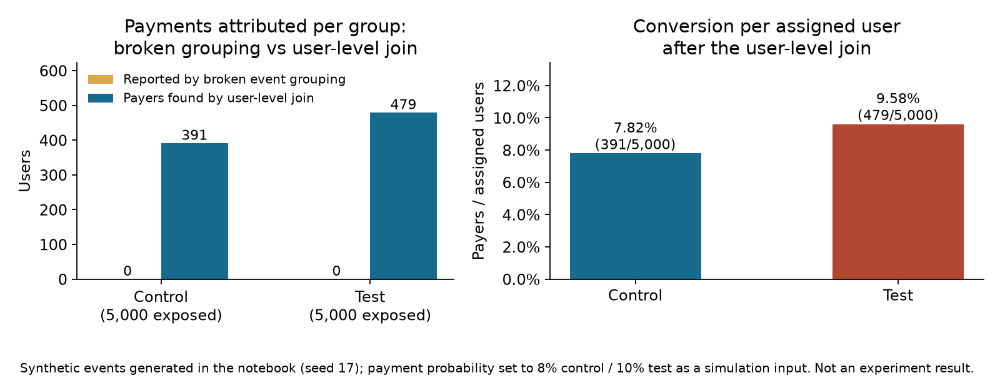

# Experiment tracking audit

## The decision

A product team sees zero conversions for both arms of the `checkout_test` experiment and must decide whether the test variant failed or the report is wrong. Before any ship decision, the case separates those two questions: validate the join from assignment to outcome, then interpret the rates.

## Data

Synthetic data, generated inside the notebook with `random.seed(17)`. No external files and no real assessment records are included.

Data-generating story: 10,000 users each receive one `experiment_exposure` event whose `event_params` carry the experiment name and group (control for even user IDs, test for odd). Each user independently draws one payment with probability 8% in control and 10% in test. `payment_done` events carry empty `event_params`, mirroring an outcome schema without treatment fields. The stream has 10,870 rows: 10,000 exposures and 870 payments. The generator emits at most one payment per user, so payment rows and payers coincide here; real data needs user-level deduplication.

## Metric contract

- **Assigned (exposed) user:** a user with one `experiment_exposure` event for `checkout_test`; the group comes from the exposure params. 5,000 users per group, assigned deterministically by user ID parity, not randomly.
- **Payer:** a user with at least one `payment_done` event, counted once per user.
- **Conversion rate:** payers divided by assigned users within the group, with non-payers kept in the denominator.
- **Broken metric:** groups `payment_done` rows by experiment fields read from the payment event itself. Those fields are absent, so every payment falls into an empty bucket and each named group reports zero.
- The simulation has no timestamps, so no observation window applies. A real analysis must define assignment or exposure time, the payment window, and eligibility rules.

## What the notebook reports (all synthetic)

- The broken grouping reports **0 payments for control and 0 for test**, despite 5,000 exposed users in each group.
- The user-level join finds **391 payers in control (7.82% of 5,000)** and **479 payers in test (9.58% of 5,000)**.
- The 8% and 10% payment probabilities are simulation inputs. The gap between the two rates is manufactured by the generator, so the rates describe this sample only and do not estimate a test effect.



The figure contrasts the broken report (zero payments in both groups) with the corrected join (payers and conversion per assigned user). It is a synthetic simulation result, not an experiment outcome.

## Limits

1. The simulation shows a tracking and join failure. It does not estimate the causal impact of a real experiment.
2. Assignment is deterministic (user ID parity), so group balance is guaranteed by construction and no randomization check exists.
3. The generator produces at most one payment per user, so payer counts equal payment rows; real payment data needs deduplication at the user level.
4. There are no timestamps, so exposure and outcome windows cannot be tested here.
5. The rate difference reflects the simulation inputs, not evidence that the variant converts better.
6. A production analysis also needs valid random assignment, stable user-level assignment, one group per user per experiment, a defined exposure and outcome window, planned comparisons and guardrails, and data quality checks (see the notebook's checklist).

## Reproduction

1. The notebook uses only the Python standard library and needs no data files. Open `2-product-experiment-tracking-audit.ipynb` in Jupyter and run all cells. The stored outputs were produced in one clean Jupyter-kernel run on 2026-11-04 (Python 3.14) and are deterministic under seed 17.
2. The published figure is generated from the repository root with:

```bash
python -m pip install matplotlib==3.10.8
python render_portfolio_figures.py
```

The script executes the notebook's code cells as its single source of truth and writes `outputs/tracking_audit.png`. Expected notebook outputs: 10,870 event rows (10,000 exposures, 870 payments), zero payments reported by the broken grouping, and 391/5,000 control versus 479/5,000 test payers after the join. The figure was verified with matplotlib 3.11.2 on 2026-11-04.
