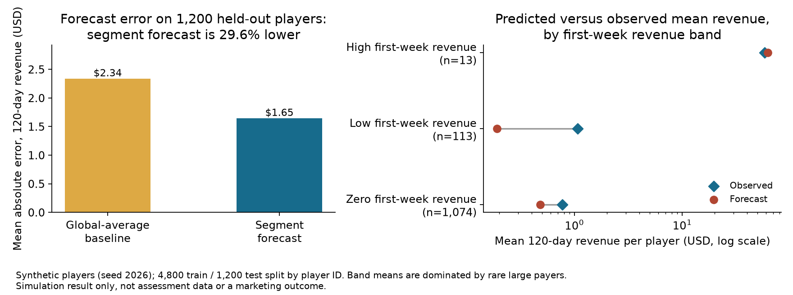

# Can we estimate player value early enough to guide ad spend?

## The decision

A mobile free-to-play game team planned to restart user acquisition. The marketing team needed an early estimate of each acquired player's revenue over the first 120 days. They wanted to compare expected revenue with acquisition cost before deciding whether to continue or increase spend.

The assessment defined lifetime value (LTV) as revenue during the first 120 days after a player's first launch. Revenue came from in-app purchases and ads.

## The data problem

The source data contain player events, including logins, purchases, level changes, tutorial completion, and ad revenue. They do not contain campaign names, acquisition channels, or ad spend. The task also does not confirm each player's full 120-day observation window.

These gaps limit the decision. A player-level revenue forecast cannot show which campaign is profitable without acquisition source and cost. An incomplete observation window can also make a player's 120-day revenue look too low.

## Analysis approach

1. Define the target as each player's purchase and ad revenue in days 0 through 119.
2. Use only first-week behavior as early predictors: revenue, active days, and tutorial completion.
3. Compare a simple segment-based forecast with a global-average baseline on held-out synthetic players. Players whose segment is unseen in training fall back to the global mean.
4. State the additional data and checks required before using a forecast to change spend.

The segment forecast estimates average 120-day revenue for players with similar first-week signals. It is a transparent benchmark, not a final production model.

## Demonstration result

The public notebook uses generated data only (seed 2026: 6,000 players, 122,767 event rows; 4,800 players train and 1,200 held out by player ID). In that simulation, the segment forecast reduced mean absolute error by 29.6% compared with the global-average baseline: $1.65 versus $2.34 on the 1,200 held-out players. This result describes the synthetic example. It is not a result from the assessment game and does not show that an advertising decision improved.



The right panel shows where the benchmark misses. First-week revenue bands are zero, low (below $1), and high ($1 or more). The forecast under-predicts realized mean 120-day revenue in the zero band ($0.48 forecast versus $0.77 observed, 1,074 players) and the low band ($0.19 versus $1.07, 113 players), and is close in the high band ($61.87 versus $58.16, 13 players). Rare large payers make these band means unstable, so treat the 29.6% improvement as a benchmark result, not a calibration guarantee.

## Recommendation

Use early player behavior to create a provisional revenue forecast. Do not use it alone to stop or scale a campaign. Before making that decision, join each player to the campaign and acquisition cost, confirm a complete 120-day outcome window, and backtest on later acquisition cohorts. Report forecast uncertainty and payback timing. Agree with marketing on the decision threshold and the cost of false stop/scale decisions.

## Working with the team

Before launch, align with marketing and data engineering on campaign identifiers, spend allocation, revenue definitions, and event ownership. Agree on the day when the forecast will guide a decision. Monitor prediction error as each cohort matures and review large forecast misses with the teams that own acquisition and game events.

## Data provenance and reproducibility

The original assessment describes an unreleased game. This repository does not include its name, event records, player identifiers, or exact results. The notebook generates a separate synthetic event dataset with `random.seed(2026)` and uses Python's standard library only.

Open [`3-player-ltv-forecast.ipynb`](3-player-ltv-forecast.ipynb) in Jupyter and run all cells. The stored outputs were produced in one clean Jupyter-kernel run on 2026-11-04 (Python 3.14) and are deterministic under seed 2026. Expected outputs: 6,000 synthetic users, 122,767 event rows, average 120-day revenue $1.09 per player, 17.1% of players with any revenue, and held-out mean absolute error of $2.34 for the baseline versus $1.65 for the segment forecast.

The published figure is generated from the repository root with:

```bash
python -m pip install matplotlib==3.10.8
python render_portfolio_figures.py
```

The script executes the notebook's code cells as its single source of truth and writes `outputs/forecast_benchmark.png`. The figure was verified with matplotlib 3.11.2 on 2026-11-04.
