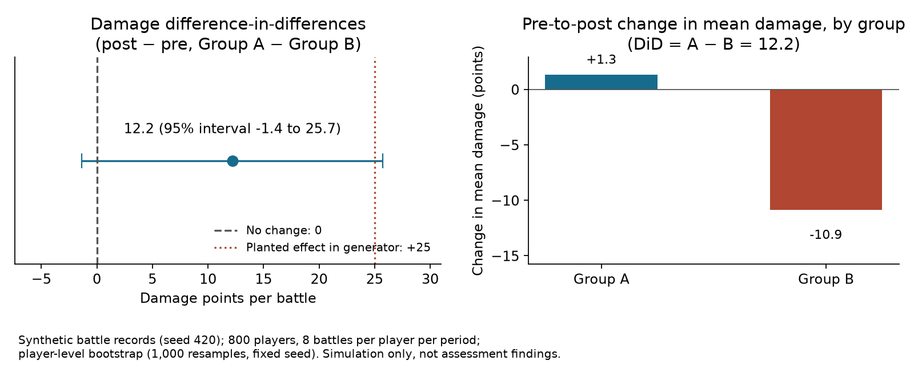

# Did a gameplay change improve player performance?

**Project 4 · Game analytics · Take-home assessment**

## The decision

A game team enabled a gameplay change for Group A from October 27 through November 29. Group B did not receive the change. The team must decide whether to expand the change, which requires knowing whether it improved battle performance.

## The analytical challenge

The original assessment notebook compared the groups with pooled average battle metrics and t-tests. Those comparisons did not isolate the change's effect. Group A and Group B differed before rollout, and each player contributed multiple battle rows. The notebook's summary also described Group A as outperforming Group B, while its displayed averages showed lower damage and kills for Group A.

## Data

All records are synthetic, generated in the notebook with `random.seed(420)`. The source assessment data are not included: no player identifiers, battle records, or exact results from the assessment game are published.

The generator creates 800 players (400 per group) with 8 battles per player per period, 12,800 rows total. It plants three known inputs: Group A starts 35 damage points below Group B, both groups share a post-period change (−20 damage, −0.02 kills, −5 seconds per battle), and the simulated feature adds 25 damage points per battle for Group A after rollout. These values are simulation inputs, not findings.

## Metric contract

- **damage** — battle damage points per battle. Primary metric (the metric with the planted effect).
- **kills** — kills per battle. Guardrail.
- **battle_seconds** — battle duration in seconds. Guardrail.
- **Period** — pre or post relative to the rollout date. The assessment scenario places the rollout from October 27 to November 29 for Group A.
- **Unit of analysis** — the player. Battles are averaged within each player and period first; each player's pre-to-post change is then compared between groups. This keeps repeated battles from one player from being treated as independent observations.
- **Difference-in-differences** — (mean player-level change in Group A) − (mean player-level change in Group B). Uncertainty comes from a player-level bootstrap (1,000 resamples, fixed per-metric seed).

## What the notebook reports (all synthetic)

- Pooled averages show Group A below Group B on damage in both periods (970.04 pre, 971.36 post, versus 991.00 and 980.12), while the pre-to-post changes point the other way: player-level changes are +1.32 for Group A and −10.88 for Group B.
- The damage difference-in-differences is **12.19 points with a 95% player-bootstrap interval of −1.36 to 25.73**. The interval includes zero and the planted +25 effect, so this sample does not establish a positive damage effect.
- Guardrail metrics stay near zero: kills difference-in-differences 0.001 (interval −0.030 to 0.032) and battle duration −2.82 seconds (interval −7.79 to 2.05).



The left panel places the estimate between the no-change reference and the planted +25 effect. The right panel shows why a pooled comparison misleads: Group A's mean damage barely moves while Group B's falls, and the DiD contrasts the two changes. Both panels describe the simulation only.

## Limits

1. The result describes one fixed-seed simulation. A single run does not validate an estimator; repeated simulations would be needed to assess bias and interval coverage.
2. The synthetic interval spans zero and the planted effect; the demonstration shows how the method behaves, not that the feature works.
3. Difference-in-differences assumes the groups would have moved in parallel without the change. The synthetic design guarantees this; a real rollout does not.
4. Pooled battle-level tests would treat 8 battles per player as independent and understate uncertainty.

Before a rollout decision, also confirm: group membership stayed fixed and the rollout date is correct; several pre-rollout periods show similar group trends; no other releases affected Group A differently; one primary outcome and guardrail metrics are defined before analysis; all battles from one player stay together when estimating uncertainty. If assignment or trend assumptions are weak, report an association and run a randomized test.

## Recommendation

Do not use a pooled comparison of all battles to decide whether to expand the change. First verify group assignment and the rollout dates. Compare the pre-to-post changes for the primary outcome and guardrail metrics. Account for repeated battles by player. If the pre-trend or assignment assumptions are weak, report the result as an association and run a randomized test before making a broad rollout decision.

## Stakeholder questions

- What player outcome is the change intended to improve?
- Was Group A assigned randomly, and did membership stay fixed?
- Were other game changes released during the same period?
- Which metrics are primary, and which are guardrails?
- What effect size would justify a wider rollout?

## Reproduction

1. The notebook uses only the Python standard library and needs no data files. Open [`4-gameplay-change-evaluation.ipynb`](4-gameplay-change-evaluation.ipynb) in Jupyter and run all cells. The stored outputs were produced in one clean Jupyter-kernel run on 2026-11-04 (Python 3.14) and are deterministic under seed 420 (the bootstrap uses its own fixed per-metric seed). Expected outputs: 12,800 battle rows, 800 players, and the group means, differences-in-differences, and bootstrap intervals quoted above.
2. The published figure is generated from the repository root with:

```bash
python -m pip install matplotlib==3.10.8
python render_portfolio_figures.py
```

The script executes the notebook's code cells as its single source of truth and writes `outputs/did_damage.png`. The figure was verified with matplotlib 3.11.2 on 2026-11-04.

## Files

- [Case folder](.)
- [Synthetic analysis notebook](4-gameplay-change-evaluation.ipynb)
