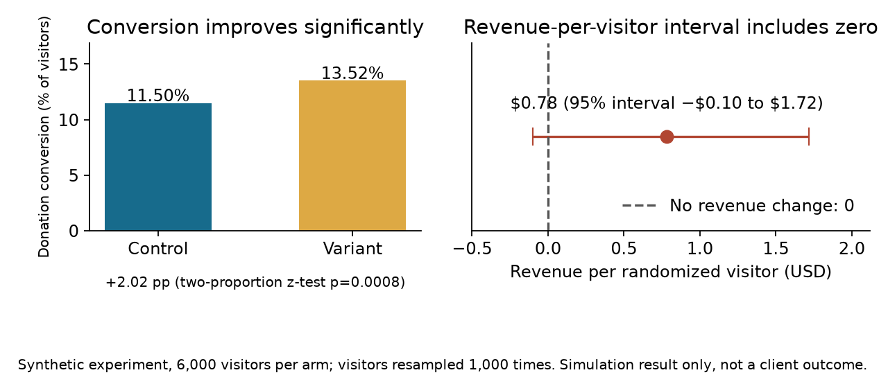

# Did removing the preset gift amount improve a donation checkout?

**Project 5 · Fundraising analytics · Take-home assessment**

## The decision

A donation platform tested a checkout change: remove the prefilled amount from the one-time giving form. The team needs to decide whether the variant raises more money per visitor, not only whether it produces more donors.

## The analytical challenge

The assessment output reported a higher donation conversion rate for the variant and a higher point estimate for revenue per checkout visitor. It also reported no detectable difference in gift amount among donors.

That result did not settle the revenue question. The assessment analysis tested conversion with a two-proportion test but tested donation event amounts among donors with a t-test. A test on gift amounts conditions on donating and cannot establish whether total revenue per randomized visitor changed. Repeated gifts from one donor also are not independent observations.

## Data

All records are synthetic, generated in the notebook with `random.seed(205)`. The original assessment records and exact results are not included.

The generator creates 12,000 randomized checkout visitors (6,000 per arm) and 17,393 event rows (checkout views and charges). A visitor can open the checkout one to three times; donors give once or through two to three recurring charges. It plants two known inputs: the variant donates more often (12.6% versus 11.6% chance per visitor) and gives slightly smaller gifts (lognormal amounts scaled by 0.92). These values are simulation inputs, not findings.

## Metric contract

- **revenue per randomized checkout visitor** — the sum of a visitor's eligible charges in the experiment window, divided by unique randomized checkout visitors in that arm, in USD. Primary decision metric. Visitors with no donation stay in the denominator with zero revenue.
- **donation conversion** — donors divided by randomized checkout visitors. Diagnostic.
- **revenue per donor** — total revenue divided by donors, in USD. Diagnostic.
- **Unit of analysis** — the visitor. Each visitor contributes one outcome row with all eligible charges summed, so repeat checkout views and repeat charges are never treated as independent observations.
- **Assignment** — the randomization unit is the visitor, with one stable group label per visitor.
- **Uncertainty** — conversion is compared with a two-sided two-proportion z-test; the revenue-per-visitor difference gets a visitor-level bootstrap interval (1,000 resamples of visitors within each arm).
- **Revenue window** — the synthetic record includes every generated charge for a visitor. A live analysis must predefine the window and decide how recurring charges, refunds, and chargebacks count.

## What the notebook reports (all synthetic)

Verified in one clean run on 2026-11-05:

- 6,000 randomized visitors per arm (12,000 total); 17,393 event rows.
- Control: 690 donors, conversion 11.50%, revenue per visitor $5.75, revenue per donor $50.03.
- Variant: 811 donors, conversion 13.52%, revenue per visitor $6.53, revenue per donor $48.35.
- Conversion difference +2.02 percentage points (two-sided p = 0.0008).
- Revenue-per-visitor difference **+$0.78 with a 95% visitor-bootstrap interval of −$0.10 to $1.72**. The interval includes zero, so this simulation does not establish a revenue-per-visitor improvement even though conversion improves clearly.



The left panel shows the conversion lift (11.50% to 13.52%, p = 0.0008). The right panel places the revenue-per-visitor difference on its interval: the interval crosses zero, so in this sample more donors did not translate into a proven revenue gain. Both panels describe the simulation only.

## Limits

1. The result describes one fixed-seed simulation. A single run does not validate an estimator; repeated simulations would be needed to assess bias and interval coverage.
2. The synthetic scenario plants a conversion lift and slightly smaller gifts. The demonstration shows how the decision metric behaves, not that the checkout change raises more money.
3. Revenue per donor is heavy-tailed in the generator (lognormal gifts), so the revenue interval is wide; this sample alone cannot rule out a small gain or a small loss per visitor.
4. Refunds and chargebacks are not simulated. A live analysis must include them in the revenue window and check that assignment labels stay stable across events.

Before shipping the change, also confirm: stable visitor assignment, the attribution window, and total visitor-level revenue with zeros included. Predefine one primary metric and guardrails, and review revenue per visitor together with conversion, gift size, recurring gifts, and refunds. If the assignment or window definitions are weak, report the result as an association and extend or rerun the test.

## Recommendation

The assessment supports a promising conversion result, but it does not prove a revenue-per-visitor improvement. Before shipping the change, verify stable visitor assignment, define the attribution window, and analyze total visitor-level revenue with zeros included. Review conversion, revenue per visitor, average gift, recurring gifts, and refunds together.

## Stakeholder questions

- Which outcome determines whether the checkout change ships: more donors or more net revenue?
- Is the assignment label written once per visitor and kept stable across events?
- Do all teams use the same definition of a checkout visitor and a completed gift?
- Are recurring gifts, refunds, and repeat gifts included in the agreed revenue window?
- Who reviews the full scorecard before a decision?

## Research notes

Microsoft's experimentation guidance stresses that outcome data must link to the randomization unit and treatment assignment. It also notes that users with no corresponding outcome must remain in the assigned population when zero is a valid outcome. [Microsoft Research: A/B Testing Across Products](https://www.microsoft.com/en-us/research/articles/a-b-testing-across-products/)

Virtuous describes revenue per visitor, conversion, average gift, and recurring-gift conversion as distinct donation-page goals. The team must select the goal that matches the campaign decision before the test starts. [Virtuous: A/B Testing in Virtuous Raise](https://virtuous.org/blog/a-b-testing-virtuous-raise/)

## Reproduction

1. The notebook uses only the Python standard library and needs no data files. Open [`5-donation-checkout-ab-test.ipynb`](5-donation-checkout-ab-test.ipynb) in Jupyter and run all cells. The stored outputs were produced in one clean Jupyter-kernel run on 2026-11-05 (Python 3.14) and are deterministic under seed 205 (the bootstrap checkpoints and restores the generator state, so re-running the resampling cell returns the same interval). Expected outputs: 12,000 visitors, 17,393 event rows, and the conversion, revenue, and interval numbers quoted above.
2. The published figure is generated from the repository root with:

```bash
python -m pip install matplotlib==3.10.8
python render_portfolio_figures.py
```

The script executes the notebook's code cells as its single source of truth and writes `outputs/revenue_per_visitor.png`. The figure was verified with matplotlib 3.11.2 on 2026-11-05.

## Files

- [Case folder](.)
- [Synthetic analysis notebook](5-donation-checkout-ab-test.ipynb)
