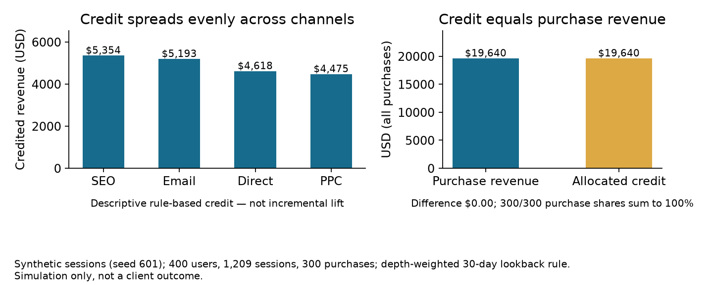

# How should revenue be shared across marketing channels?

**Project 6 · Marketing attribution · Take-home assessment**

## The decision

A marketing team wants to compare four acquisition channels (PPC, SEO, Direct, Email). A visitor can return through different channels before making a purchase. The assessment asks for a rule that shares each purchase across the visitor's sessions in the prior 30 days.

## The attribution rule

The rule assigns a depth score to each session based on the deepest funnel step reached:

| Funnel step | Score |
| --- | ---: |
| Page view | 1 |
| Content download | 2 |
| Add to cart | 3 |
| Purchase | 4 |

For each purchase, the rule assigns each eligible session a share equal to its depth divided by the sum of depths across all eligible sessions. It then multiplies that share by the purchase revenue.

- **Eligible session** — a session by the same visitor that started in the 30 days up to the purchase time, including the purchase session itself. A session's depth counts only events that occurred by the purchase time.
- **Credit share** — session depth divided by the sum of eligible session depths for that purchase. Shares sum to 1 (100%) for every purchase.
- **Credited revenue** — purchase revenue multiplied by the credit share, in USD. The allocation grain is one row per purchase and eligible session.
- **Channel credit** — credited revenue summed by the session's channel, with fractional purchase credit as the purchase-count denominator. This is descriptive reporting credit, not incremental revenue.
- **Reconciliation** — credited revenue summed across channels equals total eligible purchase revenue.

## Data

All records are synthetic, generated in the notebook with `random.seed(601)`. The generated records do not reproduce the assessment dataset or its results.

The generator creates 400 visitors with one to five sessions each across a 60-day period from 2024-01-01: 1,209 sessions and 3,000 funnel events, including 300 purchases. Each session's funnel depth is drawn uniformly from one to four steps, its channel is chosen uniformly from the four channels, and purchase revenue is lognormal. These values are simulation inputs, not findings.

## Implementation

The notebook stores the synthetic log in SQLite with separate `users`, `sessions`, and `events` tables. One SQL query finds each purchase's eligible sessions, measures each session's deepest funnel step at the purchase time, and allocates revenue in proportion to session depth. The notebook then verifies the rule twice: every purchase's shares sum to 100%, and total allocated revenue equals eligible purchase revenue, with a coverage check that every purchase received credit.

## What the notebook reports (all synthetic)

Verified in one clean run on 2026-11-05:

- 400 visitors, 1,209 sessions, 3,000 events, 300 purchases.
- 599 purchase-session credit rows across the 300 purchase paths (about 2 eligible sessions per purchase).
- All 300 of 300 purchase paths pass both checks: each purchase's shares sum to 100%, and allocated revenue equals that purchase's revenue.
- Total purchase revenue $19,640.10; total credited revenue $19,640.10; difference $0.00.
- Credited revenue by channel: SEO $5,353.52 (80.17 fractional purchases), Email $5,193.39 (79.17), Direct $4,617.79 (74.67), PPC $4,475.41 (66.00). Fractional purchase credit sums to 300.00 (displayed values rounded to two decimals).



The left panel shows how the rule splits credit: under this synthetic mix the four channels land within a $878 range (SEO $5,354 to PPC $4,475), so the rule does not concentrate credit in one channel. The right panel is the reconciliation check: allocated credit equals purchase revenue to the cent, and every purchase's shares sum to 100%. Both panels describe the simulation only.

## Limits

1. This rule is a reporting convention. It does not prove that a channel caused the purchase or generated incremental revenue. Use experiments or other causal measurement to assess channel impact.
2. Channels are assigned uniformly at random in the generator, so the even credit spread reflects the simulation design, not a property of real channel mix.
3. The dataset has no campaign cost. Add cost by channel and campaign before using these credits to calculate return on ad spend.
4. The 30-day window and the depth weights are choices; other choices change the allocation. Sessions outside the window receive no credit, and one session can be credited for several purchases by the same visitor.
5. The result describes one fixed-seed simulation.

Agree on the 30-day window, the depth weights, the treatment of direct traffic, and the inclusion of the purchase session with marketing before using the report.

## Recommendation

Use these credits as a transparent reporting convention, not as evidence of channel impact. Agree the rule (window, weights, direct traffic) before publishing, add campaign cost before any return-on-ad-spend use, and run randomized lift tests before reallocating budget based on the credits.

## Stakeholder questions

- Which decision consumes these credits: reporting, budgeting, or partner payout?
- Who owns the agreed rule, and how often is it reviewed?
- Would a different window or weights change a budget decision?
- What evidence would justify moving budget: credit differences or lift tests?

## Research notes

Google Analytics describes attribution as assigning fractional conversion credit across touchpoints. This case uses a fixed, transparent rule based on funnel depth rather than a data-driven model. [Google Analytics: Attribution](https://support.google.com/analytics/answer/10596866)

Research that compared advertising measurement methods with randomized experiments found that observational methods often failed to recover experimental effects. This supports treating rule-based credit as descriptive, not causal. [Gordon et al., Marketing Science](https://pubsonline.informs.org/doi/10.1287/mksc.2018.1135)

## Reproduction

1. The notebook uses only the Python standard library (including SQLite via `sqlite3`) and needs no data files. Open [`6-funnel-channel-attribution.ipynb`](6-funnel-channel-attribution.ipynb) in Jupyter and run all cells. The stored outputs were produced in one clean Jupyter-kernel run on 2026-11-05 (Python 3.14) and are deterministic under seed 601. Expected outputs: 400 users, 1,209 sessions, 3,000 events, 300 purchases, and the channel credits and reconciliation quoted above.
2. The published figure is generated from the repository root with:

```bash
python -m pip install matplotlib==3.10.8
python render_portfolio_figures.py
```

The script executes the notebook's code cells as its single source of truth and writes `outputs/credit_by_channel.png`. The figure was verified with matplotlib 3.11.2 on 2026-11-05.

## Files

- [Case folder](.)
- [Synthetic analysis notebook](6-funnel-channel-attribution.ipynb)
