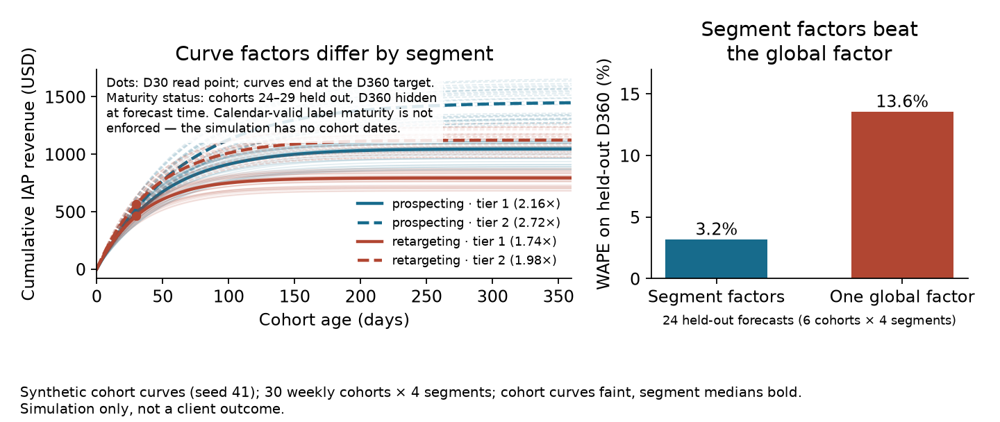

# Cohort LTV roll-forward

**Project 7 · Player valuation · Take-home assessment**

## The decision

A mobile-game assessment asked for weekly in-app purchase (IAP) cohorts, cumulative revenue through day 360, and a day-360 estimate for an immature cohort. The team must choose a roll-forward method that can be validated before it is trusted for decisions. This case is a reproducible example of projecting day-360 IAP revenue from a day-30 cohort result. It focuses on two practical safeguards: normalize keys before joining coefficient tables, and compare forecast factors on held-out synthetic curves. This is not yet a calendar-valid historical backtest.

## Data

All records are synthetic, generated in the notebook with `random.seed(41)`. They do not represent any employer or assessment findings.

The generator creates 30 weekly cohorts across four segments (campaign type × geo tier) as smooth cumulative-revenue curves over days 0–360: 120 curves. Segments differ in revenue scale and maturation speed; each cohort adds modest size and shape noise. The supplied coefficient-table mismatch from the assessment (`tier` versus `tier_inapp`) is reproduced as a small schema example. These values are simulation inputs, not findings.

## Metric contract

- **Cohort age** — the integer number of days from install to revenue event. Weeks start Monday.
- **D30 / D360** — cumulative IAP revenue through day 30 / day 360, in USD. The target is IAP revenue only — not profit, ROAS, ad revenue, or total player value.
- **Segment factor** — the median of mature training-cohort `D360 / D30` ratios, one per segment (campaign type and geo tier). The forecast multiplies a cohort's observed D30 by its segment factor.
- **Global factor** — the same median pooled over all training cohort-segments. Baseline for comparison.
- **WAPE** — Σ|forecast − actual| ÷ Σ actual over the held-out rows. Signed bias is Σ(forecast − actual) ÷ Σ actual.
- **Split** — cohorts 0–23 train, cohorts 24–29 are held out. Forecasts use only the held-out cohorts' D30 values; hidden D360 totals are used only after forecasting, for scoring.

## What the notebook reports (all synthetic)

Verified in one clean run on 2026-11-05:

- 120 synthetic cohort-segment curves; 24 training cohorts and 6 holdout cohorts (24 held-out forecasts: 6 cohorts × 4 segments).
- Segment factors (median D360/D30 over the 24 training cohorts): prospecting tier 1 = 2.157×, prospecting tier 2 = 2.724×, retargeting tier 1 = 1.737×, retargeting tier 2 = 1.976×. The single global factor is 2.076×.
- **Segment-factor WAPE 3.2%, versus 13.6% for one global factor** on the six held-out cohorts. Signed bias +1.7% (segment) versus −2.9% (global).
- The schema check passes after explicit `tier` → `tier_inapp` normalization.



The left panel shows the synthetic curves grouped by their curve factor (segment): the faint lines are the 30 cohort curves, the bold lines their segment medians, and the dots the D30 read points whose ratio to D360 defines each factor. The maturity annotation records that the held-out cohorts' D360 values were hidden at forecast time and that calendar-valid label maturity is **not enforced** in this demonstration. The right panel scores both factor methods on the same held-out forecasts: the segment factors cut WAPE from 13.6% to 3.2%. Both panels describe the simulation only.

## Limits

1. **Historical validation limit:** the example has cohort sequence numbers, not actual cohort-start and forecast dates. For weekly cohorts 0–29, a D30 forecast for cohort 24 occurs on day 198, before even cohort 0 has a mature D360 outcome. The reported WAPE therefore demonstrates a held-out curve comparison only. Before using the result as historical forecasting evidence, add dates and admit training labels only when `training_cohort_start + 360 days <= forecast_as_of`. Generate sufficient prior history and repeat over rolling cutoffs.
2. The synthetic curves are deliberately stable enough for the segment method to demonstrate well. A real analysis needs rolling historical backtests, cohort-count safeguards, uncertainty, and drift monitoring.
3. The result describes one fixed-seed simulation; it is not a performance claim about any game or production model.
4. This data contains IAP revenue only. It does not support conclusions about ad revenue, acquisition profitability, ROAS, or causal channel performance.
5. The assessment's single-cohort power curve is not enough to establish D360 reliability: a power function can produce a negative value at day zero and continue growing rather than approaching a limit. Compare candidate curves and multiplier baselines in chronological backtests before choosing one.

## Method

1. Generate 30 synthetic cohort curves with campaign and geo-tier differences.
2. Estimate segment multipliers from the first 24 cohorts, using their generated day-30 and day-360 values. Calendar availability is not enforced in this demonstration.
3. Forecast the last six cohorts using their day-30 values, then compare predictions with their hidden day-360 results.
4. Demonstrate explicit normalization of a coefficient-table key named `tier` to match the revenue table's `tier_inapp` key.

## Recommendation

Do not treat this WAPE as historical forecasting evidence. Before using roll-forward factors for acquisition or budget decisions, add real cohort dates, admit training labels only when they are mature at the forecast cutoff, and repeat the comparison over rolling cutoffs. Fix key mismatches explicitly (`tier` → `tier_inapp`) and report a missing factor as missing — not replaced with an unreviewed default. If a segment has too few mature training cohorts, withhold its prediction or use a documented fallback with an uncertainty flag.

## Stakeholder questions

- Which decisions consume the D360 forecast: acquisition bids, budgeting, or valuation?
- How many mature cohorts does each segment have at the forecast cutoff?
- What drift in observed D30/D360 ratios triggers a refit?
- Who owns the coefficient table's keys and validity dates?

## Research notes

- [AppsFlyer: pitfalls of LTV modeling](https://www.appsflyer.com/blog/measurement-analytics/overcoming-ltv-modeling-pitfalls/)
- [GameAnalytics: determining player value with curve fitting](https://www.gameanalytics.com/blog/golden-curve-determining-player-value-freemium-apps)

## Reproduction

1. The notebook uses only the Python standard library and needs no data files. Open [`7-cohort-ltv-roll-forward.ipynb`](7-cohort-ltv-roll-forward.ipynb) in Jupyter and run all cells. The stored outputs were produced in one clean Jupyter-kernel run on 2026-11-05 (Python 3.14) and are deterministic under seed 41. Expected outputs: 120 curves, the segment and global factors, WAPE 3.2% versus 13.6%, signed bias +1.7% versus −2.9%, and the schema check result quoted above.
2. The published figure is generated from the repository root with:

```bash
python -m pip install matplotlib==3.10.8
python render_portfolio_figures.py
```

The script executes the notebook's code cells as its single source of truth and writes `outputs/curve_factors.png`. The figure was verified with matplotlib 3.11.2 on 2026-11-05.

## Files

- [Case folder](.)
- [Synthetic analysis notebook](7-cohort-ltv-roll-forward.ipynb)
