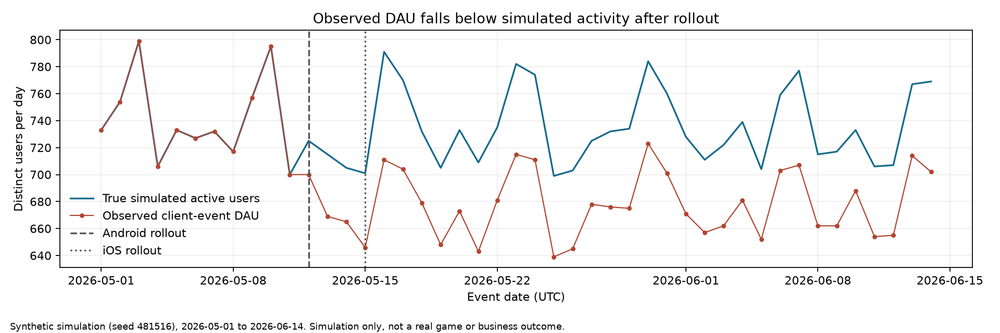

# Did the SDK release break DAU measurement?

> **Fictional portfolio case.** The game, incident, event records, and results are synthetic. This project does not describe a real employer or business outcome.

**Project 8 · Measurement reliability · Synthetic incident investigation**

## Business question

A mobile game dashboard reports a DAU decline after a staged analytics SDK rollout. Should the team change acquisition or product plans, or investigate its event tracking first?

## Dataset

`data/events.csv` contains generated client events from 1 May through 14 June 2026. It has event and received timestamps (naive UTC for this simulation), user IDs, platform, app version, country, and acquisition channel. The deterministic generator (seed 481516) injects:

- ordinary day-to-day variation in active users;
- an SDK rollout for Android on 12 May and iOS on 15 May;
- missing user IDs for 8% of upgraded players on all of their client events, plus a small pre-rollout background rate;
- retry duplicates on some post-rollout session-start events;
- longer event delivery delays after rollout.

`data/simulation_truth.csv` contains the known active-user totals used to validate this simulation. It is an evaluation oracle — not an input available to an analyst in a real incident. The operational diagnosis section below is kept separate from this oracle for that reason; an independent operational diagnosis remains an extension this case does not perform.

Regenerate both files from this directory with:

```bash
python generate_data.py
```

Regeneration is byte-identical (verified 2026-11-05).

## Metric contract

- **Observed DAU** — distinct non-null user IDs with an `app_open` or `session_start` event, by UTC event date. The dashboard-style metric under investigation.
- **True simulated DAU** — the generator's known active-user count per day (the oracle). Used only to measure identity loss in this simulation.
- **Coverage** — observed DAU ÷ true simulated DAU, per day.
- **Missing ID share** — event rows with a blank `user_id` ÷ all event rows, by day and app version.
- **Retry share** — event rows with a `_retry` event ID ÷ all event rows. The suffix exists only because this generator controls the data; in production use a documented idempotency key or validated event fingerprint.
- **Delivery delay** — received timestamp minus event timestamp, in hours; summarized as the daily 95th percentile.
- **Snapshot visibility** — distinct identified users visible at day end (D+1 00:00 UTC) and at a 24-hour snapshot (D+2 00:00 UTC), compared with the final event-time count.

## Analysis

Open [`8-mobile-sdk-metric-drop.ipynb`](8-mobile-sdk-metric-drop.ipynb) in Jupyter. The notebook:

1. defines observed DAU as distinct non-null users with an `app_open` or `session_start` event;
2. compares observed DAU with the simulation truth;
3. checks missing IDs, retry rows, and event delivery delays by day and app version;
4. compares what is visible at day end and at a 24-hour snapshot with the final event-time count;
5. explains why a date-aligned change is not, by itself, causal evidence.

Install the notebook dependencies with `pip install -r requirements.txt`.

## Findings in the generated sample

Verified in one clean run on 2026-11-05:

- 97,599 event rows, 2026-05-01 to 2026-06-14.
- Before rollout, mean true DAU is 741.2 and mean observed DAU is 741.2 (coverage 100%). After both platforms rolled out, mean true DAU is 736.2 — near the same baseline — while mean observed DAU falls to 678.0 (coverage 92.1%).
- On app version 4.8.0 (both platforms) the missing-ID share is 8.0% of rows, the retry share is 1.2%, and the 95th-percentile delivery delay is 5.2 hours (Android) and 5.0 hours (iOS). Pre-rollout versions show 0.5% missing IDs (background), no retries, and a 0.5-hour p95 delay.
- Retry duplicates (855 rows) add event volume but do not change the distinct-user DAU metric used here.
- Delivery delay makes day-end counts incomplete on 27 of 45 days (40 missing user-days, worst day 5 users). Every event in this sample arrives within 9.0 hours, so the 24-hour snapshot already equals the final event-time count on every day — the freshness risk shows at shorter horizons, and a production pipeline with longer delay tails could backfill historical DAU after the snapshot too.



The observed series tracks simulated activity exactly until the Android rollout (12 May) and separates further after the iOS rollout (15 May), while true simulated activity stays near its baseline. This gap is the measurement failure injected by the generator, not a real decline in player activity. Two supporting charts are saved alongside it: `outputs/event_quality_diagnostics.png` (missing-ID share, retry share, and delivery delay by day) and `outputs/observed_dau_by_platform.png` (each platform's DAU dropping after its own rollout). All panels describe the simulation only.

These are expected properties of the generator, not discoveries about a real game. Do not copy simulation figures into a CV as business impact.

## Recommendation in a real incident

Temporarily mark client-event DAU as provisional. Check ID completeness, duplicate handling, event delay, rollout coverage, and agreement with an independent server-side activity source. Do not alter UA budgets or product features based only on a degraded dashboard. The independent server-side comparison and engineering validation are the operational diagnosis; in this fictional case that work remains an extension and is not performed.

## Limitations

The rollout is not randomized. There is no real backend log, campaign-cost table, or experiment design. The simulation cannot prove the SDK caused a real decline or estimate business impact. A real investigation needs the event contract, rollout logs, server-side activity, and engineering validation. The retry-detection suffix and the truth table exist only because the data are simulated.

## Reproduction

1. Regenerate the data with `python generate_data.py` in this directory (Python standard library only, seed 481516; byte-identical output verified 2026-11-05).
2. Install `requirements.txt` (pandas ≥ 2.0, matplotlib ≥ 3.7) and run all notebook cells. The stored outputs were produced in one clean Jupyter-kernel run on 2026-11-05 (Python 3.14, pandas 3.1.1, matplotlib 3.11.2). Expected outputs: 97,599 event rows, the before/after summary table (coverage 100% → 92.1%), the version table quoted above, and the snapshot comparison (day-end short on 27 of 45 days; 24-hour snapshot complete).
3. The notebook's charts follow the portfolio figure rules and save themselves to `outputs/` (`observed_vs_true_dau.png`, `event_quality_diagnostics.png`, `observed_dau_by_platform.png`), so the figures cannot drift from the notebook's numbers.

## Files

- [Case folder](.)
- [Synthetic analysis notebook](8-mobile-sdk-metric-drop.ipynb)
- [Deterministic data generator](generate_data.py)
- `data/events.csv`, `data/simulation_truth.csv`
